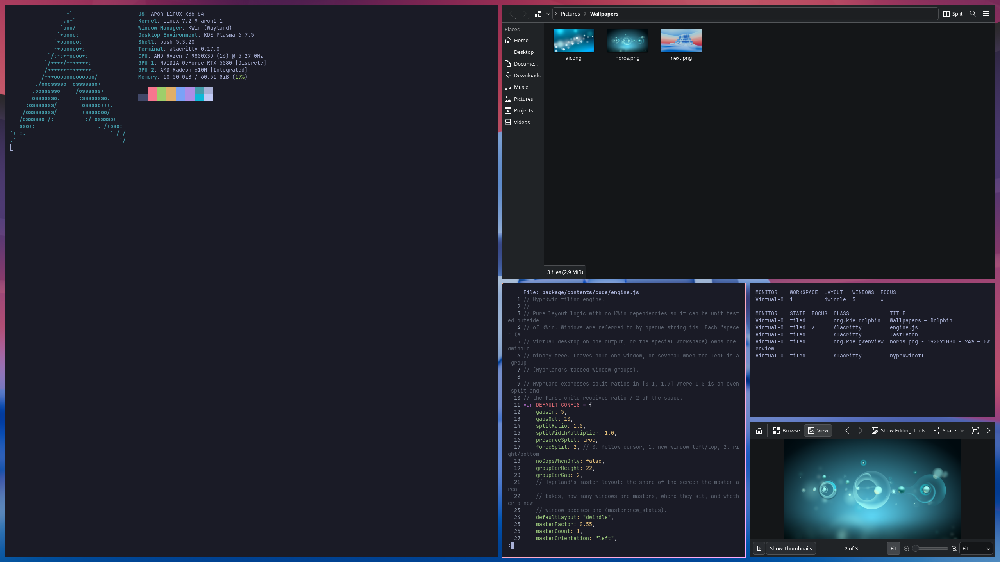
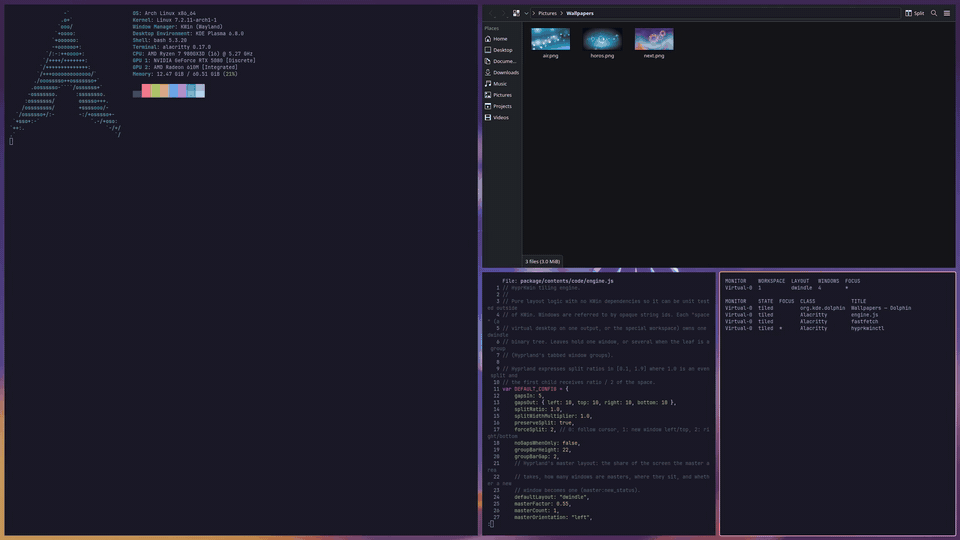
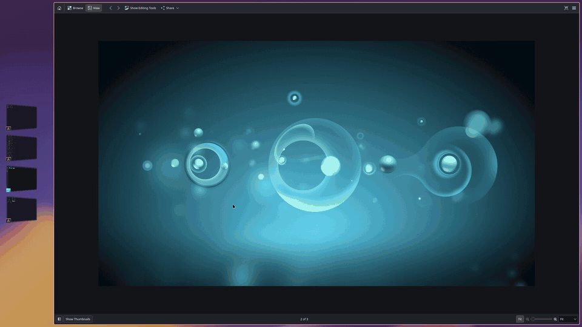
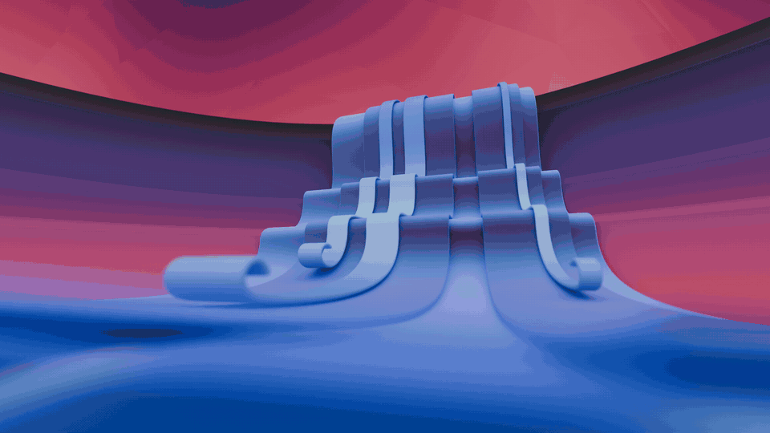
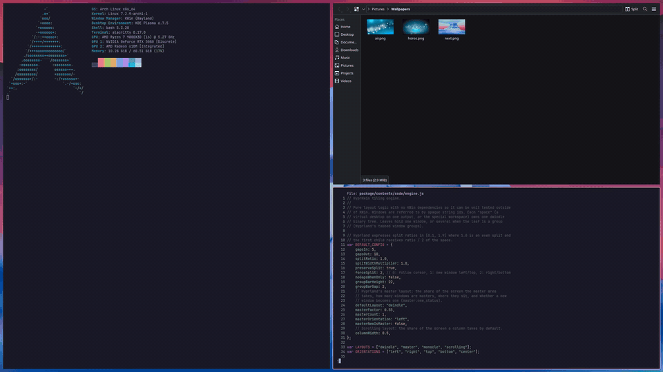
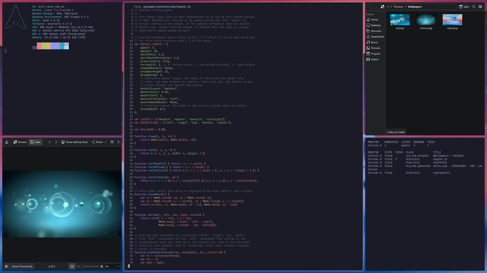
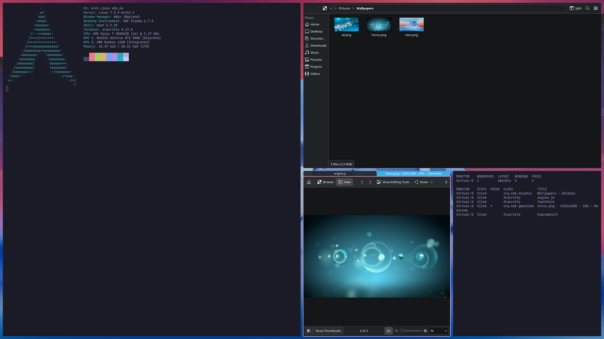
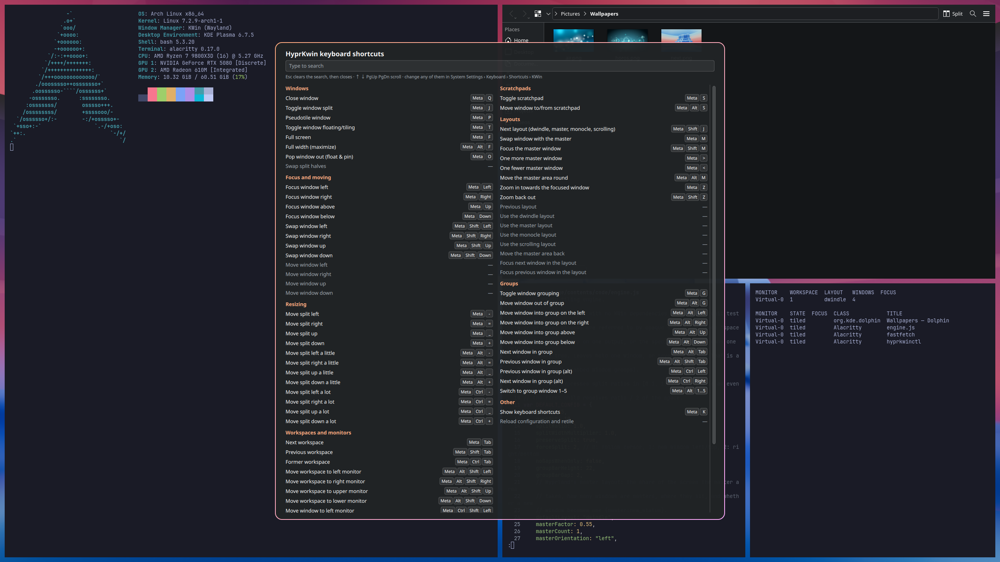

# HyprKwin

Automatic, keyboard-driven tiling for KDE Plasma 6, as a KWin script.
Windows arrange themselves as they open, and you move between them, resize
them and send them to other workspaces from the keyboard. You keep all of
Plasma: panels, widgets, the task manager, Overview, virtual desktops,
activities, window rules, KRunner and System Settings.

On the KDE Store: [HyprKwin](https://www.opendesktop.org/p/2375015/) and
[HyprKwin animations](https://www.opendesktop.org/p/2375020/) — both install
from System Settings' "Get New…".

*Dwindle on Plasma 6.7 (Breeze Dark, no panel) with a gradient focus border:
Alacritty, Dolphin, Gwenview and `hyprkwinctl`.*

- **Five layouts**, chosen per workspace and remembered between sessions:
  - **dwindle**: each new window halves the focused one, along its longer
    side;
  - **master**: one big window (or several) beside a stack of the rest, on
    any side or in the middle with a column either side;
  - **monocle**: one window at a time, full size;
  - **scrolling**: a strip of columns you move along, wider than the screen;
  - **stage**, after macOS's Stage Manager: one window on the stage, with
    live, clickable previews of the rest in a strip beside it.
- **Workspaces are Plasma's virtual desktops**, created as you need them.
  Every monitor can have its own, so switching workspace only changes the
  monitor you are on. Pager, Overview and the desktop switcher keep working.
- **Multi-monitor**: focus, swap and move windows across monitors with the
  same keys as within one, and swap two monitors' workspaces.
- **Groups (tabbed windows)**: several windows share one tile, with a
  clickable tab bar.
- **Scratchpads**: a workspace of its own that slides over whichever one
  you are on, for the terminal or music player you call up and dismiss.
  Up to four more you name yourself.
- **Zoom**: Meta+Z zooms into part of a crowded dwindle layout; tiles too
  small to use show as their app's icon until you do.
- **Focus indicator** you choose: a coloured border in the gap (one colour,
  your colour scheme's accent, or a gradient, with rounded corners if you
  like), Plasma's own window decorations, or nothing.
- **Mouse too**: Meta+drag a window onto another to re-tile it there,
  Meta+right-drag (or drag an edge) to resize. Optional focus-follows-mouse.
- **Rules** for how particular apps open (float, size, workspace, monitor,
  opacity, …) and for workspaces (which monitor, which layout, which gaps).
- **Animations**: a companion KWin effect slides windows into their new
  tile instead of jumping.
- **Settings page** in System Settings › Window Management › KWin Scripts,
  and **Meta+K** for every shortcut on the key it has now, searchable.
- **For power users**: key modes you define (say, a key that makes the
  arrows resize until Escape), and `hyprkwinctl` for scripts and status
  bars.

**Coming from Hyprland?** The default keys are Hyprland's, rules use
`hyprland.conf` syntax, and your existing `hyprland.conf` can be imported:
settings, window and workspace rules, and keybindings. See
[Importing a hyprland.conf](docs/rules-and-scripting.md#importing-a-hyprlandconf).

## See it

All five layouts on the same windows: dwindle, master (round every side),
monocle, scrolling and stage.

The stage layout, after macOS's Stage Manager: click a preview to bring it
onto the stage, or drag one on to share it.

| Windows tile as they open | The scratchpad, over any workspace |
|---|---|
|  |  |

| Master, in the middle | Groups (tabbed windows) | The keys guide (Meta+K) |
|---|---|---|
|  |  |  |

## Install

Plasma 6.6 (the LTS release) or 6.8, on Wayland.

1. System Settings › Window Management › KWin Scripts › "Get New…", search
   for **HyprKwin**, install it and tick it.
2. For the animations: Desktop Effects › "Get New…", search for **HyprKwin
   animations**, install it, log out and back in once (KWin only finds a new
   effect when it starts), and tick it.
3. Plasma already uses some of HyprKwin's keys (Meta+Left, Meta+1…). HyprKwin
   says which a few seconds after it starts, with the one command that hands
   them over.

Then press **Meta+K** for every shortcut, on the keys it has now. Release
files, installing from the repository (which hands the keys over and backs
your shortcuts up first) and uninstalling are in
[Getting started](docs/getting-started.md).

## Documentation

- [Getting started](docs/getting-started.md): installing, the animations,
  the default keys and handing Plasma's over, uninstalling.
- [Settings](docs/settings.md): layouts, workspaces and monitors, zoom,
  scratchpads, the focus indicator, and everything else on the settings
  page.
- [Rules and scripting](docs/rules-and-scripting.md): window rules,
  workspace rules and submaps (key modes), `hyprkwinctl` for scripts and
  status bars, and importing a `hyprland.conf`.
- [Troubleshooting](docs/troubleshooting.md): keys that do nothing, missing
  animations, what HyprKwin cannot do, and reporting a problem.
- [Compatibility](docs/compatibility.md): what stays stable across upgrades.
- [Development](docs/development.md): building and testing.

## Compatibility

HyprKwin supports Plasma's LTS and current releases on Wayland: 6.6 and
6.8, both tested before every release. Your settings, your
own key choices, your rules and the `hyprkwinctl` commands scripts use carry
over every upgrade; [docs/compatibility.md](docs/compatibility.md) lists
exactly what is kept stable, and what is not.

## License

See [LICENSE](LICENSE).
