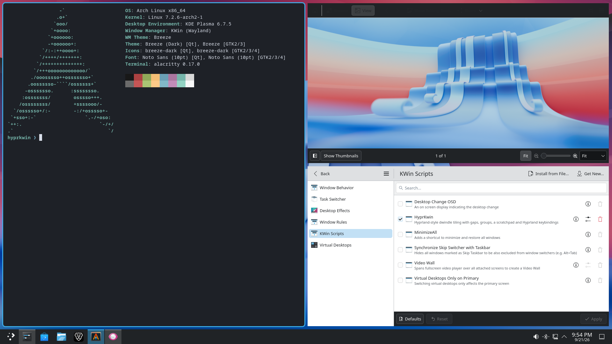

# HyprKwin

Hyprland-style dwindle tiling for KDE Plasma 6, implemented as a KWin script.
You keep all of Plasma: panels, widgets, the task manager, Overview, virtual
desktops, activities, window rules, KRunner and System Settings.

On the KDE Store: [HyprKwin](https://www.opendesktop.org/p/2375015/) and
[HyprKwin animations](https://www.opendesktop.org/p/2375020/) — both install
from System Settings' "Get New…".

*Alacritty, Gwenview and System Settings tiled by HyprKwin on Plasma 6.7
(Breeze Dark), with the rounded focus border and the stock Plasma panel.*

- **Dwindle layout** with Hyprland's semantics: splits along the longer side,
  `gaps_in` / `gaps_out`, `default_split_ratio` (same units as Hyprland),
  `preserve_split`, `force_split`, `split_width_multiplier`, `togglesplit`,
  pseudotiling.
- **Master, monocle and scrolling layouts** as well, chosen per workspace: a
  master area with `mfact`, several masters, and the master area on any side
  or in the middle (the three-column layout); or a niri-style strip of
  columns you scroll through.
- **Workspaces = Plasma virtual desktops** (created on demand), and every
  monitor gets its own, as in Hyprland. Pager, Overview and the desktop
  switcher keep working.
- **Groups (tabbed windows)** with a clickable tab bar, like Hyprland's
  `togglegroup` / `moveintogroup` / `changegroupactive`.
- **Special workspaces (scratchpads)**: `togglespecialworkspace` and
  `movetoworkspace special`, with up to four more you name yourself.
- **Workspace rules**: pin a workspace to a monitor, say what each monitor
  starts on, and give a workspace its own layout and gaps.
- **Focus indicator** you choose: a Hyprland-style coloured border in the gap,
  optionally with rounded corners, following your colour scheme — or Plasma's
  own window decorations, or nothing.
- **Mouse**: Meta+drag a tiled window onto another to re-tile it there,
  Meta+right-drag (or drag an edge) to resize the split live. Optional
  focus-follows-mouse.
- **Window rules** in Hyprland syntax (`float, class:^(org\.kde\.kcalc)$`).
- **Multi-monitor**: every monitor gets its own workspaces, as in Hyprland —
  a second display comes up on workspace 2, and switching workspace only
  changes the monitor you are on. Directional focus, swap and move across
  monitors, plus swapping two monitors' workspaces.
- **Animations**: a companion KWin effect slides and stretches windows into
  their new tile, like Hyprland's `animations { windows }`.
- **Settings page** in System Settings › Window Management › KWin Scripts.
- **Importer** for an existing `hyprland.conf`: settings, window and
  workspace rules, and keybindings.
- **Submaps** — a key enters a mode where plain keys act until Escape — and
  `hyprkwinctl`, a `hyprctl`-style command for scripts and status bars.

## Install

Plasma 6.6, 6.7 or 6.8, on Wayland.

1. System Settings › Window Management › KWin Scripts › "Get New…", search
   for **HyprKwin**, install it and tick it.
2. For the animations: Desktop Effects › "Get New…", search for **HyprKwin
   animations**, install it, log out and back in once (KWin only finds a new
   effect when it starts), and tick it.
3. Plasma already uses some of HyprKwin's keys (Meta+Left, Meta+1…). HyprKwin
   says which a few seconds after it starts, with the one command that hands
   them over.

Then press **Meta+K** for every shortcut, on the keys it has now. Release
files, installing from the repository (which hands the keys over and backs
your shortcuts up first) and uninstalling are in
[Getting started](docs/getting-started.md).

## Documentation

- [Getting started](docs/getting-started.md): installing, the animations,
  the default keys and handing Plasma's over, uninstalling.
- [Settings](docs/settings.md): layouts, workspaces and monitors, zoom,
  scratchpads, the focus indicator, and everything else on the settings
  page.
- [Rules and scripting](docs/rules-and-scripting.md): window rules,
  workspace rules and submaps in `hyprland.conf` syntax, `hyprkwinctl` for
  scripts and status bars, and importing a `hyprland.conf`.
- [Troubleshooting](docs/troubleshooting.md): keys that do nothing, missing
  animations, what HyprKwin cannot do, and reporting a problem.
- [Compatibility](docs/compatibility.md): what stays stable across upgrades.
- [Development](docs/development.md): building and testing.

## Compatibility

HyprKwin supports Plasma 6.6, 6.7 and 6.8 on Wayland. Your settings, your
own key choices, your rules and the `hyprkwinctl` commands scripts use carry
over every upgrade; [docs/compatibility.md](docs/compatibility.md) lists
exactly what is kept stable, and what is not.

## License

See [LICENSE](LICENSE).
